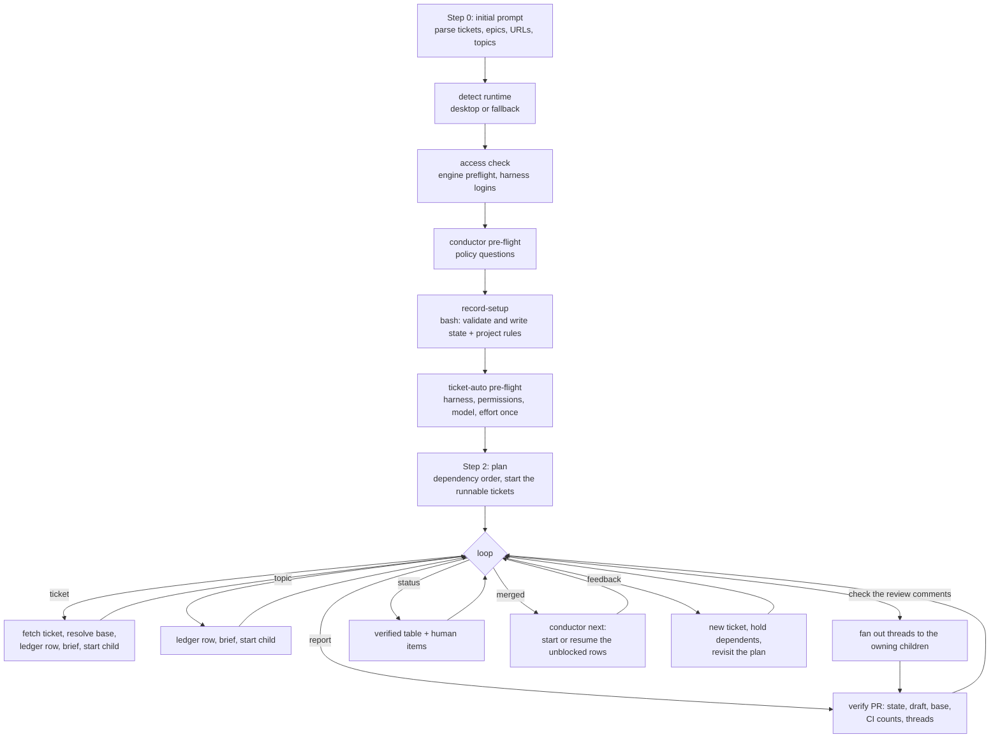

# conductor

<!-- This README is the source of truth for how the workflow
     LOOKS to users. Keep it in sync with workflow.yaml and the
     /wise-conductor skill. See CONTRIBUTING.md §9.6 for the
     invariant. -->

A conductor session coordinates many parallel child sessions from one
main thread. Each child handles one ticket or one topic. The conductor
and its children send messages in both directions. The user stays in
the conductor thread for the whole effort, which can last days and
cover dozens of tickets, an epic, or loose topics.

`/wise-conductor` is the entry point. This workflow is its setup: it
asks the conductor's policy questions once and records them in
persistent conductor state. It runs no model and changes no file in the
project. Every ticket child then runs `ticket-auto` with the setup
fully pre-answered, so no child asks again.

## Design decision

The conductor is a skill that calls `ticket-auto`, plus this small setup
workflow. It is not a new mode of `ticket-auto` and it does not fork
`ticket-auto` logic.

- Child sessions, sidebar nesting and session messages belong to the
  main harness. A headless engine child cannot start or message a Claude
  Desktop session, so the conductor loop must run in the main
  conversation: the `/wise-conductor` skill.
- `ticket-auto` stays the unit of work for one ticket. Each ticket child
  starts one `ticket-auto` run with the `wise_run` arguments the
  conductor generates.
- The conductor is autonomous by default. A request that names tickets
  approves the whole run of each ticket: start, PR, review, fixes and the
  merge when green. Neither the conductor nor a child asks about these.
- Two opt-in policies keep a PR for manual review: `merge_policy: never`
  and `pr_state: draft-then-ready`. They reach `ticket-auto` as settled
  decisions in the run context (`merge_policy: never`, `pr_draft: yes`).
  A plain `ticket-auto` run passes neither, so its pre-flight and its
  merge are unchanged.
- The state the conductor must keep for days (setup, ledger, per-project
  rules) is tested engine code in `wise_engine/conductor.py`, exposed as
  `wise-helpers.py conductor <action>`.

## When to use

- You work through an epic or a release with many tickets and want one
  child session per ticket, in parallel.
- You want to mix ticket work with loose investigation topics and keep
  one ledger of all of it.
- You want each ticket taken from start to merge without questions, in
  dependency order, on the right release branch, with green CI and no
  open review thread.

## When not to use

- One ticket: run `/wise-workflow-run ticket-auto` directly.
- You want the epic's children to run as one engine run with a
  dependency graph: run `ticket-auto` with the epic ref. It fans out
  inside one run.

## Prerequisites

- The wise engine (`/wise-init`), `gh` logged in, and every harness the
  `ticket-auto` tuning uses logged in. The conductor checks this before
  the setup questions (L2).
- A tracker this session can reach (MCP, CLI or a public URL). The
  conductor fetches every ticket itself (L1).
- Claude Desktop for the sidebar tree and session messages. Other
  clients use the fallback (below).

## Flow



## Steps

| Step | Type | Description |
|---|---|---|
| `record-setup` | `bash` | Runs `wise-helpers.py conductor init --from-env`. It validates every answer (allowed values, a valid fixed branch, a release pattern with known placeholders that gives a valid branch name) and writes `<wise-data>/conductor/<cwd-slug>/<conductor_id>/state.json` and the per-project rules `project.json`. A rerun replaces the setup and keeps the ledger and the stored `ticket-auto` answers. |

## Inputs (the setup questions)

Defaults come first in every choice.

| Input | Values | Default | Meaning |
|---|---|---|---|
| `conductor_id` | `[A-Za-z0-9._-]`, max 80 | - | The conductor session id (or a short name). The skill sets it. |
| `conductor_mode` | `desktop` \| `fallback` | `fallback` | Where children run. The skill sets it from the tools it has. |
| `base_rule` | `default` \| `fixed` \| `release` | `default` | The base branch rule, resolved per ticket (L4). |
| `base_fixed` | branch name | blank | The fixed base, for `base_rule: fixed`. |
| `release_field` | field name | `fixVersion` | The ticket's release field, for `base_rule: release`. |
| `release_pattern` | pattern | `release-{version}` | Release to branch. `{version}` replaces dots with dashes, `{raw}` keeps the value, `{major}` / `{minor}` / `{patch}` pick parts. `26.11.0` maps to `release-26-11-0`. |
| `release_missing` | `default` \| `stop` | `default` | A ticket without a release value: use the default branch and record it, or hold the ticket. Two different release values hold the ticket. |
| `merge_policy` | `green` \| `never` | `green` | Merge when CI is green and every review comment is handled, or keep the PR for manual review. |
| `pr_state` | `ready` \| `draft-then-ready` | `ready` | Ready for review when opened, or draft during the child's run and ready at the end (L7). |
| `questions` | `none` \| `allowed` | `none` | `none` is fully unattended: every question is pre-answered in the brief (L8). |
| `overlap` | `follow-base` \| `stop` | `follow-base` | Follow the convention on the base branch, never undo another ticket's fix, record each conflict in an `Overlap` section of the PR body (L9). |
| `auth_fallback` | `stop` \| `direct` | `stop` | On `AUTH_REQUIRED`: report once and stop that child, or implement directly with the same quality bar (L2). |
| `tracker_writeback` | `no` \| `yes` | `no` | Post tracker comments or not. |
| `poll_seconds` | 15 to 3600 | `60` | The tracker checks every child and its PR at this interval. |
| `stall_minutes` | 1 to 1440 | `15` | A child with no report and no push for this time is stalled. The conductor pings it. |

The harness, model and effort for each `ticket-auto` step come from the
`ticket-auto` pre-flight, asked once in the same setup. "One choice for
all step groups" is its first option. The skill stores those answers with
`conductor set-answers`. Per-child answers (`worktree`, `input.*`) are
never stored: the conductor sets them for each child.

## Outputs

| Output | Where | Description |
|---|---|---|
| Conductor state | `<wise-data>/conductor/<cwd-slug>/<id>/state.json` | Setup, `ticket-auto` answers, ledger, learned expected CI jobs per base branch. |
| Project rules | `<wise-data>/conductor/<cwd-slug>/project.json` | Base rule and mapping, merge policy, PR state, worktree pattern, expected CI jobs. A later conductor of the same workspace starts from them. |

`<wise-data>` is `$XDG_DATA_HOME/wise`, else `~/.local/share/wise`.

## Child sessions

| Kind | Started when | What it runs |
|---|---|---|
| Ticket child | The user names a ticket that the tracker knows (Jira, Linear, GitHub Issues, or any tracker this session can reach) | `ticket-auto` with the setup, fully pre-answered |
| Topic child | The user asks for a session on any other subject | A plain session with the user's brief, no workflow |

Both kinds get the same two-way messaging with the conductor.

### Ticket child brief

`conductor brief` writes a self-contained brief:

1. The ticket key, title, description and comments, fetched by the
   conductor (L1).
2. The worktree rules. `ticket-auto` (worktree_mode `new`) fetches
   `origin/<base>` and adds the worktree itself. A child that implements
   directly first runs `git fetch origin <base>` and
   `git worktree add ../<repo>.<KEY> -b <KEY> origin/<base>` (L3).
3. The full setup as fixed answers, including the exact `wise_run`
   arguments for `ticket-auto`. Every `ticket-auto` pre-flight question
   is answered, so `wise_run` never returns `MISSING_ANSWERS`.
4. The overlap rule and the sibling PRs the conductor knows in the same
   area (L9).
5. The definition of done: a PR on the right base, green CI with every
   expected job, merged when green (or kept unmerged under the `never`
   policy), a test that fails on the old code for each fix, no end of
   turn while CI runs, and a report of what changed and what was not
   verified by hand (L5, L6, L11, L13).
6. The autonomy contract, the child's code and the conductor's session id.
   The child asks nothing about the start, the PR, the review or the
   merge. It stops and reports only for the stop cases (see Autonomy).

### `ticket-auto` with the conductor policy

The child's run context carries `decisions.merge_policy` and
`decisions.pr_draft`. With `pr_draft: yes` the unit opens the PR with
`--draft`. With `merge_policy: never` the watch loop runs as usual (CI,
bot threads, local review per head, fixes) and, at the point where it
would merge, runs `gh pr ready` (draft PRs only) and ends the unit with
the verdict `ready`. The worktree is kept. No merge guard can fire on a
draft, and nothing is merged.

## Claude Desktop behavior

1. Detection at runtime: `conductor mode --tools <names>` reports
   `desktop` when `mcp__ccd_session__start_session` and a session
   messaging tool are both available. Environment variables are not used.
2. Each child starts with `mcp__ccd_session__start_session`,
   `initiation: "user_asked"`, so the sidebar shows it nested under the
   conductor session.
3. Each child gets a short stable name (the lowercased ticket key, for
   example `proj-12`) and a title under 60 characters.
4. Conductor to child: messages go to the child's `local_...` session id,
   never to a display name.
5. Child to conductor: the child's turn-end report reaches the conductor
   on its own. A blocked child messages the conductor's session id.
6. The conductor binds every child PR to its own session (`bind_pr`) as
   soon as the PR exists, so its PR panel lists every PR of the effort.
   The client sets the panel order. The status report gives the work
   order (blocked, open, working, merged, closed).
7. The tracker runs under the `Monitor` tool, so each `EVENT` line wakes
   the conductor. Without `Monitor`, it runs as a background shell
   command, and the conductor reads its output on each turn.

## Fallback behavior

Outside Claude Desktop (plain CLI, other harnesses) the conductor prints
once that the sidebar tree is not available. Children run as background
agents (named after the ledger row) or as `ticket-auto` engine runs
started from `conductor payload`. The ledger, the briefs, verification,
the status report and the review-comment round stay the same.

## Conductor duties

- Ledger: one row per child with ticket or topic, session id and name,
  worktree, branch, base branch, PR number, state (`queued`, `starting`,
  `running`, `waiting`, `held`, `ready`, `merged`, `closed`, `failed`),
  dependencies (`depends_on`), last verified CI result, open review
  threads, manual QA items and notes.
- Verify before reporting: `conductor verify` folds `gh pr view`,
  `gh pr checks` and the GraphQL review threads into the row. CI is green
  only when nothing fails or is pending and every expected job ran. The
  first green run on a base records its job names, so a later run that
  drops a job is `incomplete` (L5). A draft with pending CI gets a nudge
  (L6). A merge under the never policy is a warning.
- Review-comment round: `conductor fanout` turns the unresolved threads of
  every open PR into one message per owning child, with thread ids and
  comment ids, and the instruction to check each finding, fix valid ones
  with a test that fails without the fix, reply with evidence on invalid
  ones, resolve the thread and wait for green CI (L10, L11).
- Reference codes: every ledger row has a stable code (`C1`, `C2`, ...)
  that never changes. The status table, the tracker events and every
  message carry it. Items that need a human are `N1`, `N2`. Each child
  brief gives the child its code and the reference-code contract. The
  child codes its findings, decisions, questions, risks and actions
  (`F1`, `D1`, `Q1`, `R1`, `A1`). It answers review threads by `T` code.
- Status report: a table of all children with the verified state, then
  the items that need a human: manual QA, decisions, cleanup (L13). The
  rows are in work order: `blocked` (CI red or incomplete, merge conflict,
  wrong base, failed child), `open` (waiting for CI, review or merge),
  `working` (no PR yet), `queued` (not started or held), `merged`,
  `closed`.
- Autonomy: a request that names tickets is the approval for each whole
  run. The conductor does not ask whether to start, open a PR, review,
  fix comments or merge. It stops a ticket and reports only in these
  cases: the fix attempts run out with CI still red, a conflict has no safe
  resolution, branch protection needs a human approval, the ticket is too
  vague to implement, or a login or an access is missing. A stopped
  ticket holds its dependents. Independent tickets continue.
- Dependency order: the conductor reads ticket links, the epic structure
  and the code areas, and records `depends_on` for each row. Tickets with
  no open dependency run in parallel, with no cap. `conductor next` lists
  the rows to start or resume after each merge. A dependent ticket starts
  from the updated base.
- Feedback and replanning: feedback on finished work becomes a new
  ticket. The conductor tells the user the new ticket and when it runs.
  When the feedback changes a running ticket, the conductor holds that
  ticket (`held`, a dependency on the new ticket) and resumes it after the
  new ticket merges.
- Alignment check: when the whole epic or topic is done, the conductor
  sends one summary with the manual QA items. It may ask the user to
  confirm that the result meets the initial requirements. This check
  never holds other work.
- Tracker: `conductor watch` runs in the background for the whole effort.
  Each `poll_seconds` it fetches every open PR and finds the PR of a child
  branch that has none yet. It folds the facts into the ledger and prints
  one `EVENT` line for each change: PR opened, ready, merged or closed, CI
  change, merge conflict, new review threads, and a child that is stalled.
  The conductor reacts to each line, tells the user, and pings a stalled
  child for its progress. Child reports and messages still reach the
  conductor directly, and `conductor seen` resets the stall timer.
- Tracker guards: every `gh` call has a 30-second timeout. A heartbeat
  file records each pass. A second watcher of the same conductor exits.
  Five failed passes in a row stop the watcher with a reason. After 240
  minutes it exits so that a fresh one starts. `conductor watch-health`
  reports `running`, `stuck` (alive, no pass for too long) or stopped,
  and `--reap` stops a stuck one. The conductor checks the health on each
  turn and starts the watcher again when it is not running.

## Lessons from the field

Each lesson is a requirement. The code in brackets says where it applies.

- **L1 [ticket child]**: A subagent inside `ticket-auto` could not reach
  the tracker connector. The conductor fetches the ticket and passes the
  full text (comments included) into the run context.
- **L2 [ticket child]**: `ticket-auto` failed with `AUTH_REQUIRED` when the
  harness CLI was not logged in. The conductor runs the pre-flight check
  before it starts children. `auth_fallback` chooses stop or direct.
- **L3 [worktree]**: A child forked from a session in a plain checkout
  shares that checkout. Every ticket gets its own worktree from a freshly
  fetched remote base. Nothing touches the user's main checkout.
- **L4 [base branch]**: Tickets in one effort can target different release
  branches. The base is resolved per ticket.
- **L5 [CI]**: The CI provider sometimes drops jobs. "No failures" is not
  green: the expected jobs must have run.
- **L6 [child lifecycle]**: Children ended their turn with CI pending and
  the PR in draft. The brief forbids it, and the conductor nudges.
- **L7 [merge]**: `ticket-auto` merged by default. Under never-merge the PR
  stays a draft during the run and becomes ready at the end.
- **L8 [questions]**: Unattended means every question is pre-answered,
  including overlap and ambiguous scope. Defaults are recorded in the PR
  body.
- **L9 [overlap]**: Tickets of one epic touch the same components. The
  child searches the tracker and the base history first, follows what is
  merged, and records conflicts in an `Overlap` section.
- **L10 [review]**: Bot reviewers found real bugs after green CI. The
  review-comment round is a core feature.
- **L11 [tests]**: A regression test that passes without the fix is
  worthless. Each fix's test must fail on the old code.
- **L12 [state]**: Long efforts outlive the context window. Setup, ledger
  and per-project rules live in persistent state.
- **L13 [manual QA]**: Children cannot do manual keyboard, zoom or
  screen-reader checks. Every report names what was not verified by hand,
  and the status report carries those items.

## Examples

```text
/wise-conductor We will work through epic PROJ-100 and some extra tickets.
/wise-conductor Fix these three tickets: PROJ-1, PROJ-2, PROJ-3.
/wise-conductor Let's work on the release 4.2 bugs.
/wise-conductor --resume
```

## Related

- [`/wise-conductor`](../../skills/wise-conductor/SKILL.md): the procedure.
- [`ticket-auto`](../ticket-auto/README.md): the unit of work of each ticket child.
- [`/wise-workflow-run`](../../skills/wise-workflow-run/SKILL.md): pre-flight, ticket fetch and the wait loop the skill reuses.
- [Workflow reference](../../../../docs/wise/workflows.md).
